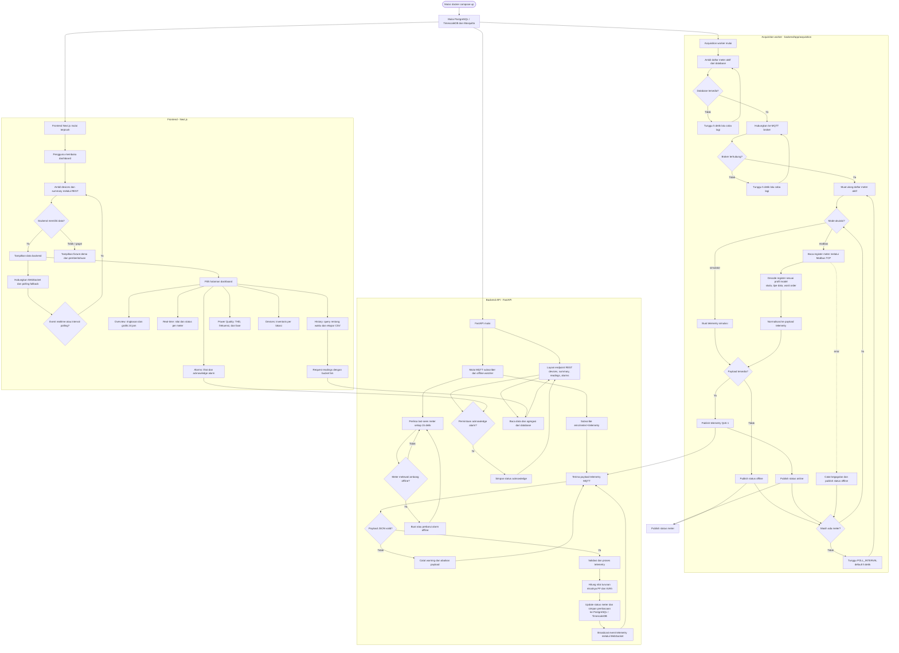
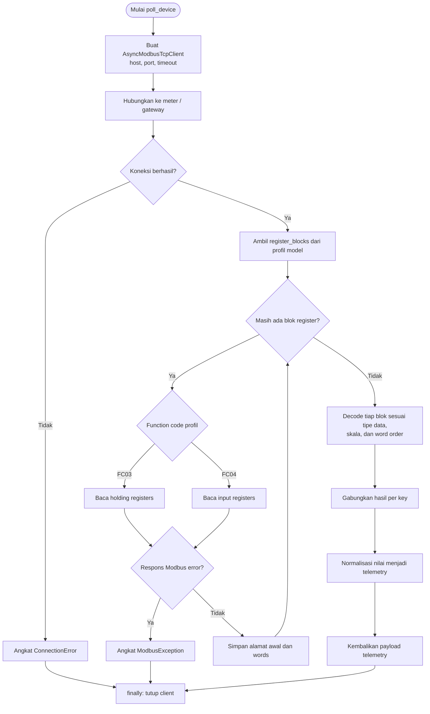
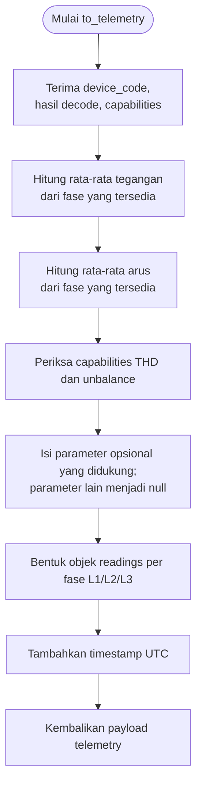
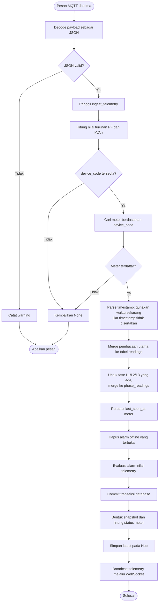
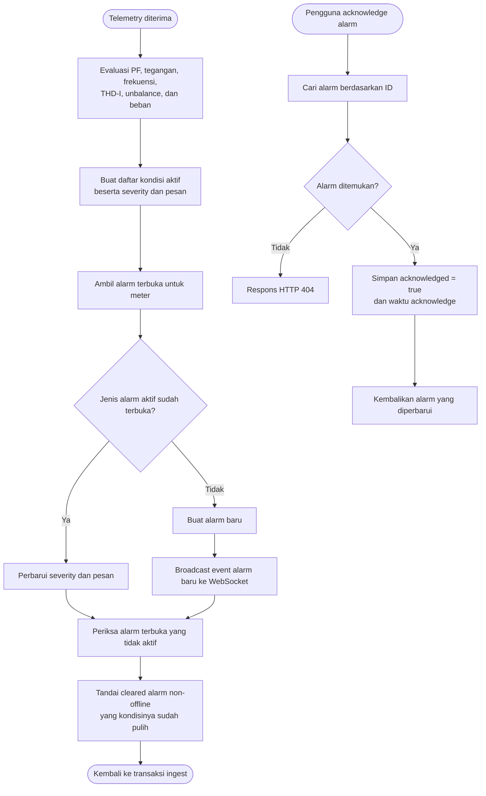
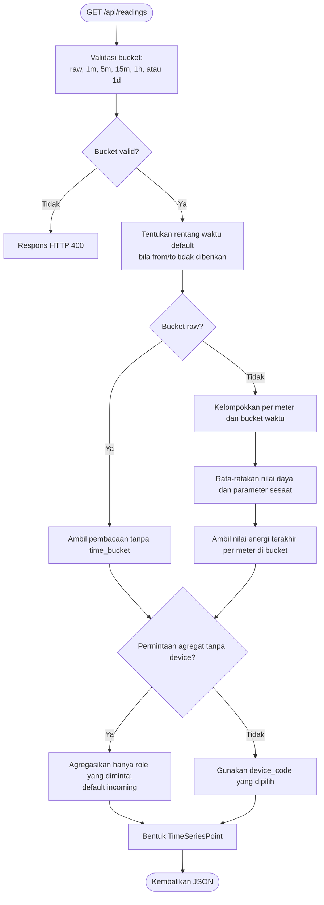
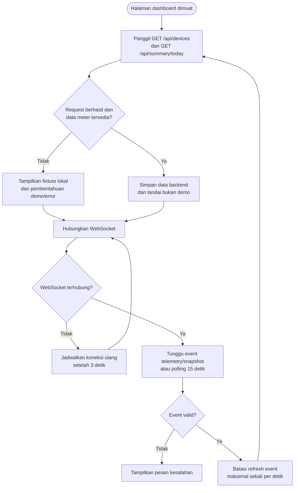

# Flowchart Program Utama EMS

Diagram ini menggambarkan alur runtime utama sistem berdasarkan implementasi
acquisition worker, backend API, database/MQTT, dan frontend. Acquisition worker
dan API berjalan sebagai proses terpisah.

## Ringkasan Alur

1. Acquisition worker mengambil meter aktif dari database, lalu memilih simulator
   atau Modbus berdasarkan `ACQUISITION_MODE`.
2. Pada mode Modbus, worker membaca register melalui Modbus TCP, mendecode
   berdasarkan profil model, lalu menormalisasi data.
3. Worker menerbitkan telemetry dan status ke Mosquitto. Interval bawaan
   acquisition adalah 5 detik.
4. Backend menerima telemetry dari MQTT, memproses dan menyimpan pembacaan,
   kemudian mengirim event realtime melalui WebSocket. REST API melayani data
   dashboard dan histori.
5. Frontend memperbarui data melalui REST berkala dan WebSocket. Bila backend
   tidak tersedia atau belum memiliki data meter, frontend dapat menampilkan
   fixture simulasi lokal dengan pemberitahuan demo.
6. Halaman History meminta bucket 5 menit untuk agregasi data; interval bucket
   berbeda dari interval polling acquisition.

## Titik Masuk Kode

- Acquisition worker: [`backend/app/acquisition/__main__.py`](../backend/app/acquisition/__main__.py)
- Poller Modbus TCP: [`backend/app/acquisition/poller.py`](../backend/app/acquisition/poller.py)
- Profil dan decoding: [`backend/app/acquisition/profiles.py`](../backend/app/acquisition/profiles.py), [`backend/app/acquisition/decoder.py`](../backend/app/acquisition/decoder.py)
- FastAPI dan lifecycle task: [`backend/app/main.py`](../backend/app/main.py)
- Subscriber MQTT: [`backend/app/services/mqtt.py`](../backend/app/services/mqtt.py)
- Frontend data hook: [`frontend/src/lib/use-ems-data.ts`](../frontend/src/lib/use-ems-data.ts)
- Halaman Overview dan permintaan histori 5 menit: [`frontend/src/app/page.tsx`](../frontend/src/app/page.tsx)

## Flowchart Subrutin

Diagram berikut merinci fungsi-fungsi penting yang dipanggil oleh alur utama.

### 1. Subrutin polling Modbus dan decoding

### 2. Subrutin normalisasi telemetry

### 3. Subrutin ingest MQTT hingga penyimpanan

### 4. Subrutin evaluasi dan acknowledge alarm

### 5. Subrutin query histori ber-bucket

### 6. Subrutin pembaruan data frontend

## Referensi Subrutin

- Modbus polling: [`backend/app/acquisition/poller.py`](../backend/app/acquisition/poller.py)
- Decode register: [`backend/app/acquisition/decoder.py`](../backend/app/acquisition/decoder.py)
- Normalisasi telemetry: [`backend/app/acquisition/normalize.py`](../backend/app/acquisition/normalize.py)
- Ingest telemetry: [`backend/app/services/ingest.py`](../backend/app/services/ingest.py)
- Perhitungan nilai turunan: [`backend/app/services/derive.py`](../backend/app/services/derive.py)
- Evaluasi alarm: [`backend/app/services/alarms.py`](../backend/app/services/alarms.py)
- Query histori dan inventaris: [`backend/app/services/queries.py`](../backend/app/services/queries.py)
- Hub WebSocket: [`backend/app/services/realtime.py`](../backend/app/services/realtime.py)
- Pembaruan data frontend: [`frontend/src/lib/use-ems-data.ts`](../frontend/src/lib/use-ems-data.ts)
