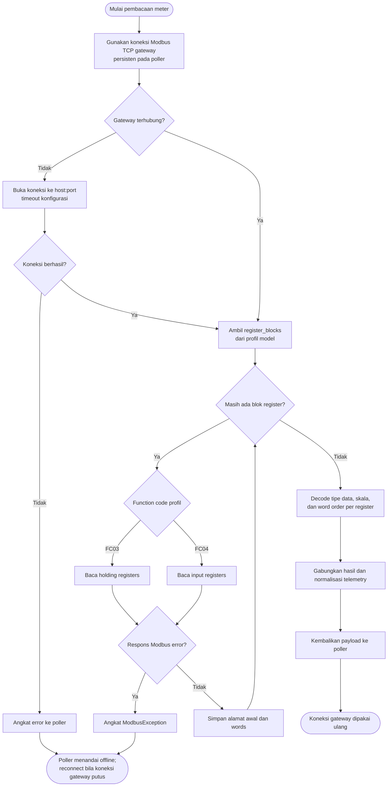
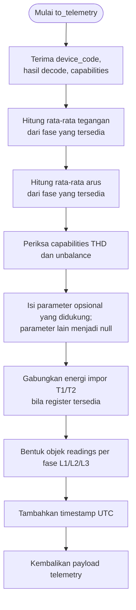
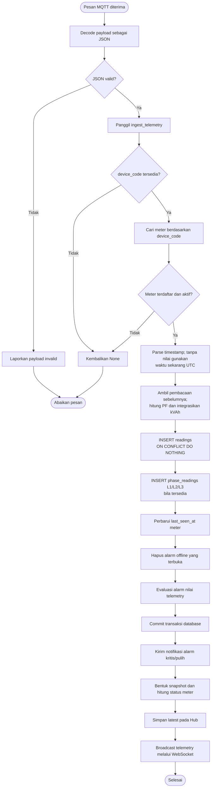
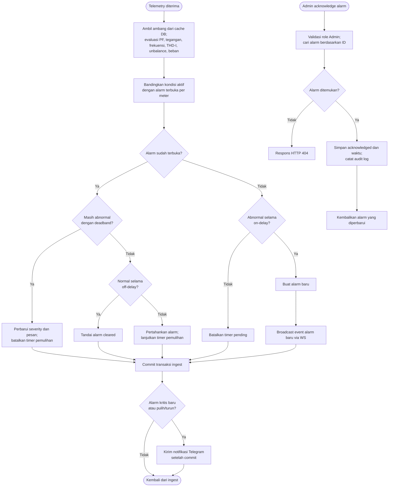
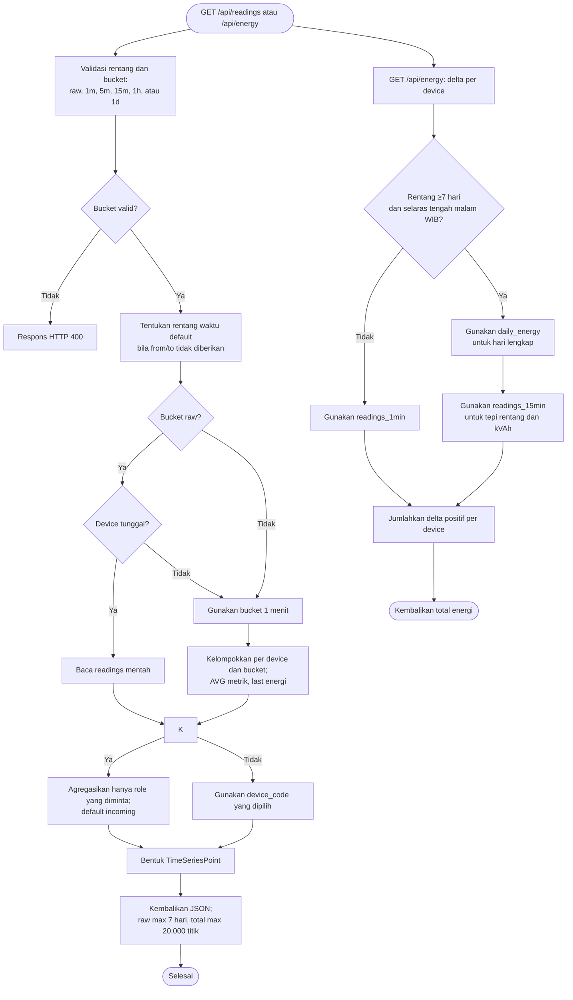
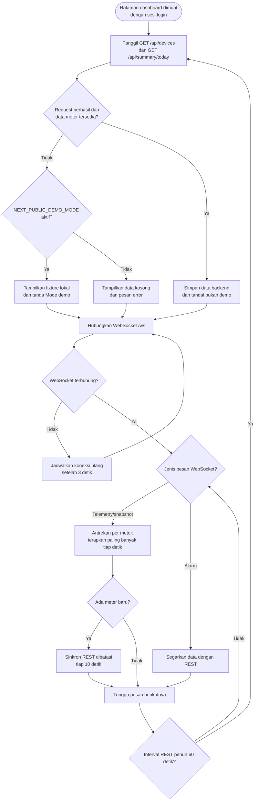

# Flowchart Program Utama EMS

> Versi flowchart dengan simbol standar laporan (terminator, proses, keputusan,
> input/output, subrutin, penyimpanan data, konektor) tersedia di
> [`flowchart/`](./flowchart/index.html): SVG, PNG, dan draw.io multi-halaman.
> Buat ulang dengan `py scripts/generate_flowcharts.py`.

Versi draw.io multi-halaman yang dapat diedit tersedia di
[`program-flowcharts.drawio`](./program-flowcharts.drawio) dan
[`flowchart/flowchart-ems.drawio`](./flowchart/flowchart-ems.drawio). Keduanya
dibuat oleh generator yang sama; diagram satu halaman, SVG, PNG, dan pratinjau
HTML juga disimpan di [`flowchart/`](./flowchart/).

Diagram ini menggambarkan alur runtime utama sistem berdasarkan implementasi
acquisition worker, backend API, database/MQTT, dan frontend. Acquisition worker
dan API berjalan sebagai proses terpisah.

```mermaid
flowchart TD
    Start([docker compose up: DB, MQTT, backend, acquisition]) --> ApiStart[FastAPI mulai]
    Start --> AcqStart[Acquisition worker mulai]
    WebStart[Frontend Next.js dijalankan terpisah] --> Login[Pengguna login]

    subgraph Acquisition["Acquisition worker - proses terpisah"]
        AcqStart --> LoadDevices[Muat meter aktif dan counter terakhir dari DB]
        LoadDevices --> LoadOK{Database tersedia?}
        LoadOK -- Tidak --> WaitDB[Laporkan error, tunggu 5 detik]
        WaitDB --> LoadDevices
        LoadOK -- Ya --> ConnectMQTT[Hubungkan ke MQTT]
        ConnectMQTT --> MQTTConnected{Broker terhubung?}
        MQTTConnected -- Tidak --> RetryMQTT[Laporkan error dan retry backoff]
        RetryMQTT --> ConnectMQTT
        MQTTConnected -- Ya --> RefreshDevices[Muat ulang meter setiap 60 detik]
        RefreshDevices --> GroupGateway[Kelompokkan per gateway]
        GroupGateway --> PollGateway[Poll gateway paralel;<br/>meter di gateway yang sama berurutan]
        PollGateway --> SelectMode{Mode akuisisi?}
        SelectMode -- simulator --> Simulate[Buat telemetry simulasi]
        SelectMode -- modbus --> ReadModbus[Baca Modbus TCP dengan profil model]
        ReadModbus --> Supported{Profil register tersedia?}
        Supported -- Tidak --> PublishOffline[Publish status offline]
        Supported -- Ya --> Normalize[Decode dan normalisasi telemetry]
        Simulate --> HasData{Payload tersedia?}
        Normalize --> HasData
        HasData -- Ya --> PublishTelemetry[Publish telemetry QoS 1]
        HasData -- Tidak --> PublishOffline
        PublishTelemetry --> PublishOnline[Publish status online]
        PublishOffline --> NextMeter{Masih ada meter?}
        PublishOnline --> NextMeter
        NextMeter -- Ya --> SelectMode
        NextMeter -- Tidak --> WaitPoll[Tunggu hingga deadline POLL_INTERVAL<br/>(default 5 detik; siklus terlambat dilewati)]
        WaitPoll --> RefreshDevices
        ReadModbus -. error baca .-> PublishOffline
        PublishTelemetry -.-> BrokerTelemetry
        PublishOnline -.-> BrokerStatus
        PublishOffline -.-> BrokerStatus
    end

    subgraph Backend["Backend API - FastAPI"]
        ApiStart --> StartTasks[Mulai REST/WS, MQTT subscriber,<br/>offline watcher dan ambang alarm]
        StartTasks --> Subscribe[Subscribe ems/meter/+/telemetry]
        Subscribe --> Receive[Terima payload telemetry MQTT]
        Receive --> ValidJSON{JSON valid?}
        ValidJSON -- Tidak --> Ignore[Catat/laporkan payload invalid]
        Ignore --> Receive
        ValidJSON -- Ya --> ActiveDevice{Device terdaftar dan aktif?}
        ActiveDevice -- Tidak --> Skip[Hitung sebagai pesan diabaikan]
        Skip --> Receive
        ActiveDevice -- Ya --> Derive[Hitung PF dan integrasikan kVAh]
        Derive --> Save[INSERT readings dan phase_readings;<br/>duplikat diabaikan]
        Save --> UpdateSeen[Perbarui last_seen_at;<br/>hapus alarm offline terbuka]
        UpdateSeen --> EvalAlarm[Evaluasi alarm telemetry<br/>(delay dan hysteresis)]
        EvalAlarm --> Commit[Commit transaksi]
        Commit --> Notify[Kirim notifikasi kritis/pulih setelah commit]
        Notify --> Broadcast[Simpan snapshot dan broadcast telemetry/alarm via WS]
        Broadcast --> Receive
        StartTasks --> Watcher[Tunggu 15 detik; periksa meter aktif]
        Watcher --> OfflineCheck{Tanpa last_seen atau melewati ambang?}
        OfflineCheck -- Ya --> CreateAlarm[Buat/perbarui alarm offline<br/>(bawaan warning >30s, critical >180s)]
        OfflineCheck -- Tidak --> Watcher
        CreateAlarm --> Watcher
        ApiStart --> REST[Layani REST; data monitoring perlu login]
        REST --> DBRead[Baca readings / aggregate / alarm dari DB]
        DBRead --> REST
        REST --> Ack{Admin acknowledge alarm?}
        Ack -- Ya --> UpdateAlarm[Simpan acknowledge dan audit log]
        UpdateAlarm --> REST
    end

    BrokerTelemetry[MQTT telemetry topic] --> Receive
    BrokerStatus[MQTT status topic]

    subgraph Frontend["Frontend - Next.js"]
        Login --> FetchREST[Ambil devices dan summary via REST]
        FetchREST --> DataAvailable{Data backend tersedia?}
        DataAvailable -- Ya --> ShowLive[Tampilkan data backend]
        DataAvailable -- Tidak --> DemoMode{NEXT_PUBLIC_DEMO_MODE aktif?}
        DemoMode -- Ya --> ShowDemo[Tampilkan fixture dan tanda Mode demo]
        DemoMode -- Tidak --> ShowError[Tampilkan data kosong dan pesan error]
        ShowLive --> SubscribeWS[Hubungkan WebSocket /ws dengan sesi login]
        ShowDemo --> SubscribeWS
        ShowError --> SubscribeWS
        SubscribeWS --> NewEvent{Pesan WebSocket?}
        NewEvent -- telemetry/snapshot --> Queue[Antrekan per meter;<br/>terapkan paling banyak sekali/detik]
        Queue --> Unknown{Meter baru?}
        Unknown -- Ya --> RefreshUnknown[Sinkron REST dibatasi 10 detik]
        Unknown -- Tidak --> WaitEvent[Tunggu event berikutnya]
        RefreshUnknown --> WaitEvent
        NewEvent -- alarm --> RefreshAlarm[Segarkan data via REST]
        RefreshAlarm --> WaitEvent
        NewEvent -- terputus --> RetryWS[Tunggu 3 detik lalu reconnect]
        RetryWS --> SubscribeWS
        WaitEvent --> FullSync{Interval sinkron 60 detik?}
        FullSync -- Ya --> FetchREST
        FullSync -- Tidak --> NewEvent
        ShowLive --> Pages[Pilih Overview, Real-time, History,<br/>Power Quality, Devices, atau Alarms]
        Pages --> HistoryQuery[History: readings/energy;<br/>default bucket 5m]
        HistoryQuery --> DBRead
    end
```

## Ringkasan Alur

1. Acquisition worker terpisah membaca konfigurasi meter aktif dari PostgreSQL,
   memuat ulang daftar tiap 60 detik, dan mem-poll pada interval bawaan 5 detik.
   Gateway berbeda dipoll paralel; meter di gateway yang sama dibaca berurutan.
2. Pada mode `modbus`, worker membaca Modbus TCP dan mendecode profil model.
   Pada mode `simulator`, telemetry dibuat tanpa hardware. Worker menerbitkan
   telemetry dan status terpisah; backend hanya subscribe topic telemetry.
3. Backend menerima telemetry, mengabaikan device tidak dikenal/nonaktif,
   menghitung PF/kVAh, menyimpan data secara idempoten, memperbarui status
   online dan alarm, lalu menyiarkan WebSocket. Kegagalan MQTT memakai retry
   backoff.
4. Offline watcher backend memeriksa meter aktif tiap 15 detik. Ambang bawaan
   adalah >30 detik untuk warning dan >180 detik untuk critical; device tanpa
   `last_seen_at` langsung critical. Ambang dapat dikonfigurasi.
5. Halaman monitoring memerlukan login. WebSocket reconnect setelah 3 detik;
   telemetry diterapkan tiap detik, alarm memicu sinkron REST, sinkron penuh
   berjalan tiap 60 detik, dan meter baru memicu sinkron terbatas tiap 10 detik.
   Fixture hanya digunakan bila `NEXT_PUBLIC_DEMO_MODE=true`; selain itu UI
   menampilkan data kosong dengan pesan error.
6. History menggunakan default bucket 5 menit. Query raw dibatasi 7 hari dan
   setiap respons time series maksimal 20.000 titik.

## Titik Masuk Kode

- Acquisition worker: [`backend/app/acquisition/__main__.py`](../backend/app/acquisition/__main__.py)
- Poller Modbus TCP: [`backend/app/acquisition/poller.py`](../backend/app/acquisition/poller.py)
- Profil dan decoding: [`backend/app/acquisition/profiles.py`](../backend/app/acquisition/profiles.py), [`backend/app/acquisition/decoder.py`](../backend/app/acquisition/decoder.py)
- FastAPI dan lifecycle task: [`backend/app/main.py`](../backend/app/main.py)
- Subscriber MQTT: [`backend/app/services/mqtt.py`](../backend/app/services/mqtt.py)
- Frontend data hook: [`frontend/src/lib/use-ems-data.ts`](../frontend/src/lib/use-ems-data.ts)
- Halaman Overview dan permintaan histori 5 menit: [`frontend/src/app/page.tsx`](../frontend/src/app/page.tsx)

## Flowchart Subrutin

Diagram berikut merinci fungsi-fungsi penting yang dipanggil oleh alur utama.

### 1. Subrutin polling Modbus dan decoding



### 2. Subrutin normalisasi telemetry



### 3. Subrutin ingest MQTT hingga penyimpanan



### 4. Subrutin evaluasi dan acknowledge alarm



### 5. Subrutin query histori ber-bucket



### 6. Subrutin pembaruan data frontend



## Referensi Subrutin

- Modbus polling: [`backend/app/acquisition/poller.py`](../backend/app/acquisition/poller.py)
- Decode register: [`backend/app/acquisition/decoder.py`](../backend/app/acquisition/decoder.py)
- Normalisasi telemetry: [`backend/app/acquisition/normalize.py`](../backend/app/acquisition/normalize.py)
- Ingest telemetry: [`backend/app/services/ingest.py`](../backend/app/services/ingest.py)
- Perhitungan nilai turunan: [`backend/app/services/derive.py`](../backend/app/services/derive.py)
- Evaluasi alarm: [`backend/app/services/alarms.py`](../backend/app/services/alarms.py)
- Query histori dan inventaris: [`backend/app/services/queries.py`](../backend/app/services/queries.py)
- Hub WebSocket: [`backend/app/services/realtime.py`](../backend/app/services/realtime.py)
- Pembaruan data frontend: [`frontend/src/lib/use-ems-data.ts`](../frontend/src/lib/use-ems-data.ts)
