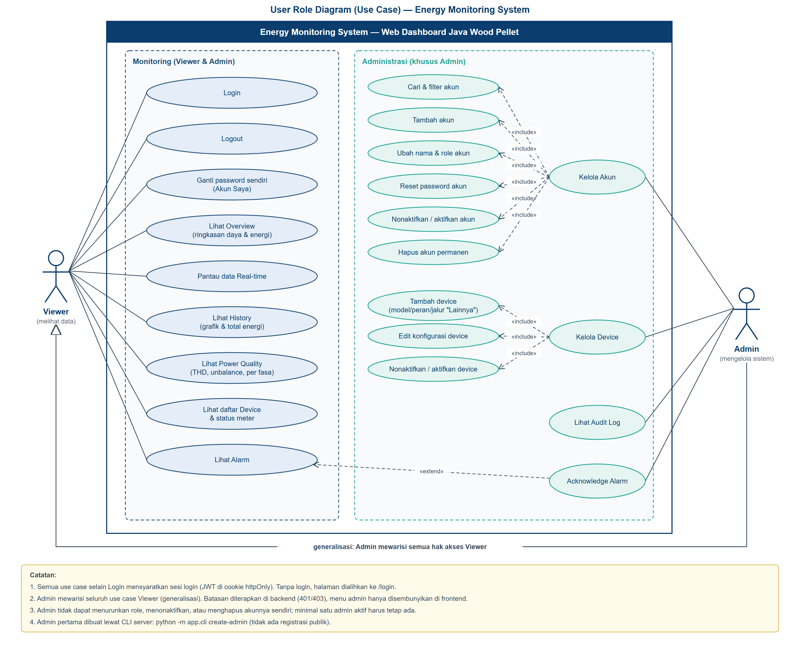

# User Role Diagram

Diagram use case untuk dua role pengguna dashboard EMS: **Viewer** dan
**Admin**. Admin mewarisi seluruh hak Viewer (generalisasi) dan menambah fitur
administrasi.



File: [SVG](./user-role/user-role-diagram.svg) ·
[PNG](./user-role/user-role-diagram.png) ·
[draw.io (bisa diedit)](./user-role/user-role-diagram.drawio)

Buat ulang setelah ada perubahan hak akses:

```bash
py scripts/generate_user_role_diagram.py
```

## Matriks hak akses

Diturunkan dari kode: `backend/app/api/__init__.py` (router wajib login),
`backend/app/api/deps.py` (`get_current_user`, `require_admin`),
`backend/app/api/admin.py`, dan `backend/app/api/alarms.py`.

| Use case | Halaman | Endpoint | Viewer | Admin |
|---|---|---|:-:|:-:|
| Login / Logout | `/login` | `POST /api/auth/login`, `/logout` | ✅ | ✅ |
| Ganti password sendiri | `/account` | `POST /api/auth/change-password` | ✅ | ✅ |
| Lihat Overview | `/` | `GET /api/summary/today`, `/api/devices` | ✅ | ✅ |
| Pantau Real-time | `/realtime` | WebSocket `/ws` | ✅ | ✅ |
| Lihat History | `/history` | `GET /api/readings`, `/api/energy` | ✅ | ✅ |
| Lihat Power Quality | `/power-quality` | `GET /api/devices` | ✅ | ✅ |
| Lihat daftar Device | `/devices` | `GET /api/devices` | ✅ | ✅ |
| Lihat Alarm | `/alarms` | `GET /api/alarms` | ✅ | ✅ |
| Acknowledge Alarm | `/alarms` | `POST /api/alarms/{id}/acknowledge` | ❌ | ✅ |
| Kelola Akun (cari, tambah, ubah, reset password, nonaktifkan, hapus) | `/admin/users` | `/api/admin/users*` | ❌ | ✅ |
| Kelola Device (tambah, edit, nonaktifkan) | `/admin/devices` | `/api/admin/devices*`, `/device-models`, `/device-options` | ❌ | ✅ |
| Lihat Audit Log | `/admin/audit` | `GET /api/admin/audit-log` | ❌ | ✅ |

Akses tanpa login dibalas `401` (frontend mengalihkan ke `/login`); Viewer yang
memanggil fitur admin dibalas `403`.

## Aturan tambahan

- Akun dibuat oleh admin; tidak ada registrasi publik. Admin pertama dibuat
  lewat CLI server: `python -m app.cli create-admin`.
- Admin tidak bisa menurunkan role, menonaktifkan, atau menghapus akunnya
  sendiri, dan minimal satu admin aktif harus selalu ada.
- Reset password, perubahan role, nonaktif, atau hapus akun langsung
  mengakhiri sesi akun tersebut di semua perangkat.
